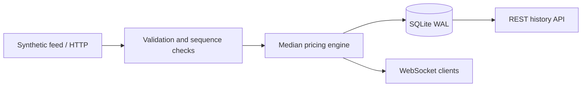

# FluxStream — Real-time FX data

**Status:** runnable portfolio prototype; synthetic data only.

A synthetic foreign exchange quote aggregation service. Ingest integer-scaled bid/ask quotes, reject stale or replayed updates, calculate a median indicative price, persist history and publish live updates to read-only WebSocket subscribers.

## Run locally
Requires Node.js 24 (Node 22.16 also tested). No npm dependencies.
```sh
npm test
npm start
```
A synthetic feed runs automatically. Disable it with `SIMULATE=0 npm start`. Each price is expressed in millionths of a currency unit.
```sh
curl 'http://localhost:8080/price?pair=EUR%2FUSD'
curl 'http://localhost:8080/history?pair=EUR%2FUSD'
curl http://localhost:8080/metrics
```
In a browser developer console, connect to the feed:
```js
const ws = new WebSocket('ws://localhost:8080/stream?pair=EUR%2FUSD');
ws.onmessage = e => console.log(JSON.parse(e.data));
```
Manual ingestion (run with simulator disabled):
```sh
curl -X POST http://localhost:8080/quotes -H 'Content-Type: application/json' -d "{\"source\":\"demo\",\"pair\":\"EUR/USD\",\"bid\":1080000,\"ask\":1080012,\"seq\":1,\"ts\":$(node -p 'Date.now()')}"
```
## Architecture

The engine commits the latest provider quote and derived historical record in one transaction. Stale providers are excluded at query time. Median midpoint and spread limit the influence of a single outlier when at least three providers are available. Slow WebSocket clients are disconnected rather than allowed to accumulate unlimited buffered data.

## Trade-offs and next steps
This is a single-process reference implementation, not an institutional benchmark or an executable trading feed. The minimal WebSocket implementation is read-only and closes on incoming frames; use a maintained RFC-compliant library before deployment. Provider sequence resets, data retention, TLS, authentication, source entitlement and durable event replay are not implemented. Kafka partitioning by currency pair, Redis snapshots, PostgreSQL/TimescaleDB, distributed tracing and Kubernetes are proposed scaling steps, not included integrations. No real market data is used.

## Docker
```sh
docker compose up --build
```
Each project uses port 8080; run separately or change the host port in compose.yaml. Docker configuration is supplied but was not executed in the authoring environment.

## Reproducible benchmark
```sh
npm run bench
```
Measured once in the authoring Linux container; not production throughput or a network load test.
```json
{
  "scope": "in-memory SQLite core, single process, no network",
  "events": 10000,
  "eventsPerSecond": 25712,
  "p95ms": 0.055644000000000915
}
```

## Repository guide
Source code, automated tests, benchmark scripts, Docker configuration and a GitHub Actions workflow are included. Review the design and run the tests before presenting this as your own portfolio work.
